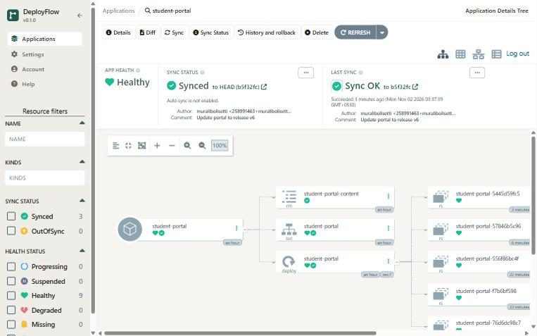
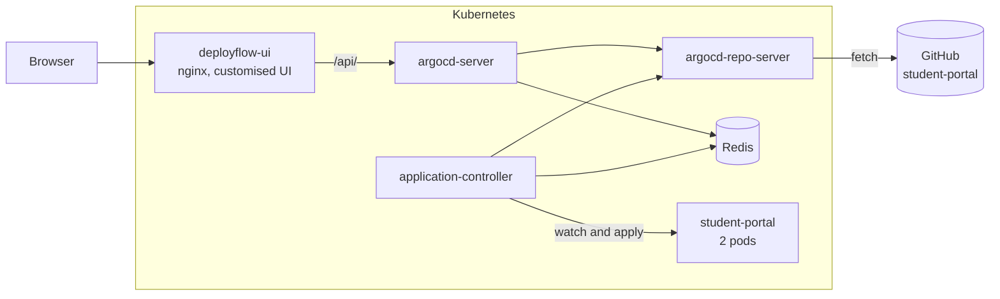
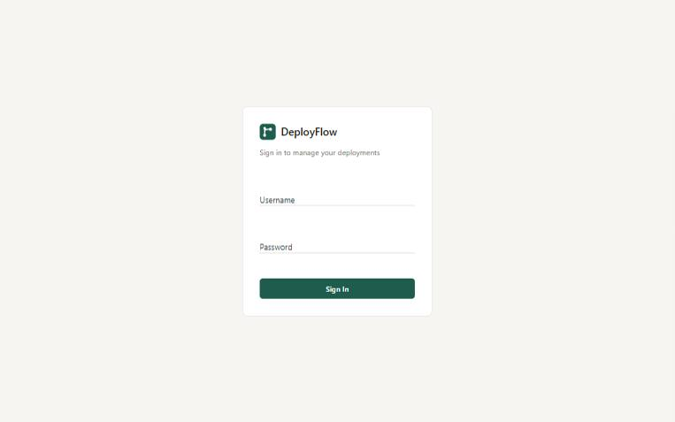
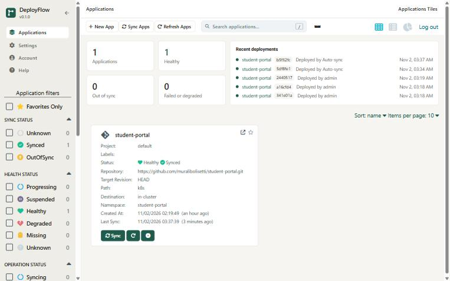
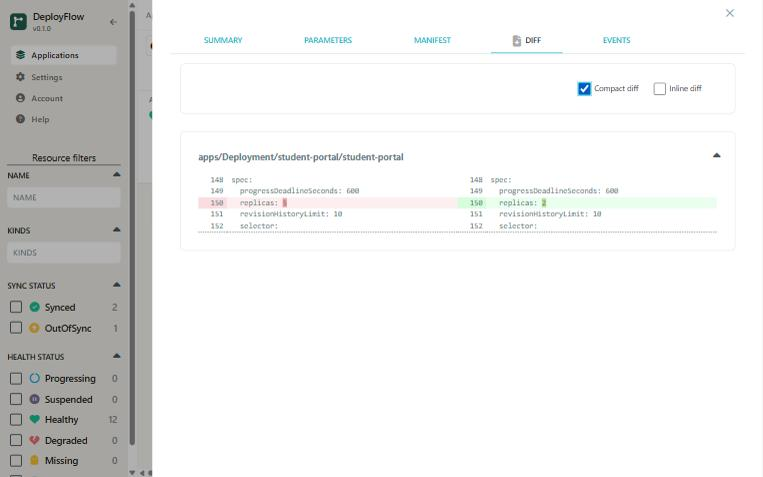
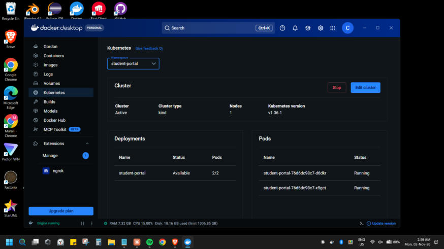

# DeployFlow

**A simplified GitOps-based Kubernetes application deployment and management platform.**

DeployFlow is a college software engineering project. It adapts the open-source [Argo CD](https://github.com/argoproj/argo-cd) project with its own interface, while using Argo CD's backend unchanged as its deployment engine.

> DeployFlow is an academic adaptation. It isn't an official Argo Project product. See [Attribution](#attribution).



## Problem statement

Deploying to Kubernetes by hand is error-prone. Changes made with `kubectl` leave no reviewable record, and clusters slowly drift away from their intended configuration. Nobody can easily answer "what should be running, and is it?"

GitOps solves this by making Git the source of truth, but full tools expose a lot of complexity. DeployFlow focuses on the essential workflow in a simple, clear interface.

## Objectives

1. Connect a Git repository of Kubernetes configuration.
2. View applications in a central dashboard.
3. Deploy applications to Kubernetes.
4. Monitor health and deployment status.
5. Detect differences between Git and the cluster.
6. Synchronize changes from Git.
7. View deployment history.
8. Roll back to an earlier version.

## Features

| Feature | Status |
|---|---|
| Git repository connection | Tested |
| Dashboard with counts and recent deployments | Tested |
| Application deployment | Tested |
| Drift (OutOfSync) detection and diff view | Tested |
| Manual synchronization | Tested |
| Health and resource status | Tested |
| Deployment history | Tested |
| Rollback | Tested |
| Custom branding and interface, light and dark | Tested |
| Automated sync and self-healing (optional) | Tested |

Results are in [docs/testing.md](docs/testing.md).

## Architecture



The browser talks only to `deployflow-ui`, which serves the interface and forwards API calls to the unmodified Argo CD server. The controller watches the cluster, compares it with Git, and applies changes.

Full details and a source-file map are in [docs/architecture.md](docs/architecture.md).

## Technology stack

| Area | Technology |
|---|---|
| GitOps engine | Argo CD `v3.5.6` |
| Interface | React 19, TypeScript, SCSS, webpack |
| Web server and proxy | nginx 1.27 |
| Orchestration | Kubernetes `v1.36.1` on Docker Desktop (cluster type kind) |
| Cache | Redis |
| Source control | Git and GitHub |
| Sample application | nginx with a ConfigMap, Deployment and Service |

## Quick start

With the system already installed, start Docker Desktop, then run this in PowerShell:

```bash
powershell -ExecutionPolicy Bypass -File \\wsl.localhost\Ubuntu\home\murali\deployflow\deploy\local\start-deployflow.ps1
```

It opens DeployFlow at <http://localhost:8080> and the sample app at <http://localhost:8090>. Sign in as `admin`. [docs/setup.md](docs/setup.md) covers the password, and how to install everything from nothing.

## Screenshots

| Sign in | Dashboard |
|---|---|
|  |  |

| Drift diff | Kubernetes in Docker Desktop |
|---|---|
|  |  |

## Documentation

| Document | Contents |
|---|---|
| [docs/setup.md](docs/setup.md) | Install, start, stop |
| [docs/demo-guide.md](docs/demo-guide.md) | Panel demonstration, step by step |
| [docs/manual-testing.md](docs/manual-testing.md) | Test every feature yourself |
| [docs/testing.md](docs/testing.md) | Test report and evidence |
| [docs/architecture.md](docs/architecture.md) | How it works, with a source-file map |
| [docs/customizations.md](docs/customizations.md) | What changed from upstream |
| [docs/viva-preparation.md](docs/viva-preparation.md) | Likely questions and answers |
| [docs/presentation-outline.md](docs/presentation-outline.md) | Slide plan |
| [docs/progress-report.md](docs/progress-report.md) | Full project report |
| [PROJECT_LOG.md](PROJECT_LOG.md) | Every decision, change, tool and issue |
| [CLAUDE.md](CLAUDE.md) | Project rules and phase status |

The sample application is a separate repository: [muralibolisetti/student-portal](https://github.com/muralibolisetti/student-portal). The upstream Argo CD README is in Git history at tag `v3.5.6`.

## Limitations

- Local, single-cluster, single-admin setup, for academic demonstration only. Don't expose it publicly.
- Argo CD's history records only successful deployments. The overview shows the latest failure separately.
- Git changes appear after a Refresh, or otherwise after polling, which can take up to about 6 minutes. Webhooks can't reach a local cluster.
- Some technical help text still links to upstream documentation.

## Future improvements

- Webhooks for instant Git detection
- A stored log of failed deployments
- HTTPS with a trusted certificate
- Multiple users with roles
- Automated end-to-end tests

## Attribution

DeployFlow is based on [Argo CD](https://github.com/argoproj/argo-cd) by the Argo Project authors, licensed under the [Apache License 2.0](LICENSE). The backend is used unmodified. Changes to the interface are listed in [docs/customizations.md](docs/customizations.md), and credit is recorded in [NOTICE](NOTICE). Argo is a trademark of its respective owners, and this project isn't affiliated with or endorsed by the Argo Project or the Cloud Native Computing Foundation.
