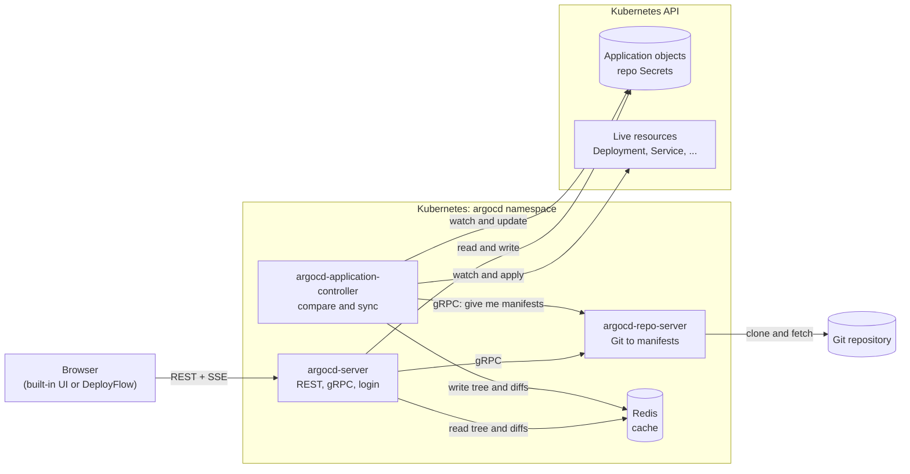
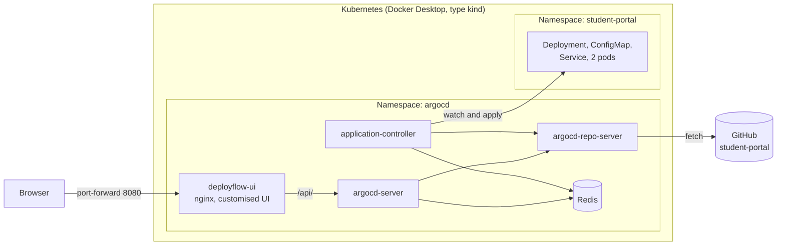

# DeployFlow architecture audit

**Status:** Phase 2 audit, based on reading the Argo CD source.
**Pinned source:** Argo CD `v3.5.6`, commit `c2b1e3017` (branch `deployflow-dev`). File and line references below apply to this commit.

## 1. How to read this document

This is a focused audit of the code paths DeployFlow depends on. It is not a review of the whole repository. `applicationset/`, `cmpserver/`, the hydrator, notifications and most of `util/` were not audited. Only the UI's data layer and its package and folder structure were read, not its components in depth.

Every claim here comes from reading the source, except where it is marked **Predicted**. Predicted items followed from the code when this was written. Most have since been confirmed on a running system: see section 8 and [testing.md](testing.md).

The DeployFlow design itself is decided in Phase 5. This document records the facts that decision needs.

## 2. The big picture

Argo CD keeps asking one question: does what is running in the cluster match what Git says should be running? If not, it reports `OutOfSync` and can apply the difference.

Three ideas explain most of the system:

1. **The `Application` object is the mailbox.** The API server and the controller never call each other. To request work, the API server writes to the `Application` object in Kubernetes. The controller watches that object and reports results in its `status`.
2. **There is no database.** Configuration lives in Kubernetes as custom resources and Secrets. Redis is only a cache.
3. **Sync is asynchronous.** A sync or rollback request only records an intention and returns. The controller does the work afterwards.

## 3. Components

All Argo CD containers use one image, `quay.io/argoproj/argocd:v3.5.6`. `cmd/main.go:42-76` picks which program to run from the name the binary was started with, or from `ARGOCD_BINARY_NAME`.

| Workload in `manifests/install.yaml` | Role | Needed for our demo? |
|---|---|---|
| `argocd-server` | REST and gRPC API, login, built-in UI | Yes |
| `argocd-repo-server` | Fetches Git, generates manifests | Yes |
| `argocd-application-controller` | Detects drift, performs syncs | Yes |
| `argocd-redis` | Cache for manifests, resource trees, diffs | Yes |
| `argocd-dex-server` | External SSO | No: local admin login is handled in `server/session/session.go` |
| `argocd-notifications-controller` | Notifications | No |
| `argocd-applicationset-controller` | ApplicationSet feature | No |

The last three can stay installed, or be scaled to zero to save memory. Scaling them down is **Predicted** to be safe and needs testing in Phase 4. Nothing needs deleting. `manifests/core-install.yaml` has no `argocd-server`, so it cannot be used.

## 4. The ten audit questions

### 4.1 How does Argo CD start?

`cmd/main.go` selects a Cobra command, for example `apiserver.NewCommand()` for `argocd-server`. Each command's `Run` builds its long-running service: the API server through `server.NewServer` (`server/server.go:313`) and `Run` (`server/server.go:579`), and the controller through `controller/appcontroller.go:955`.

### 4.2 How does the API server work?

`Run` uses `cmux` to serve several protocols on one port (`server/server.go:628`). Service logic is written as gRPC services and registered in `newGRPCServer` (`server/server.go:916`). `newHTTPServer` (`server/server.go:1173`) exposes them as REST through grpc-gateway, one `mustRegisterGWHandler` call per service. The URLs come from annotations in the `.proto` files.

Every call passes through `Authenticate` (`server/server.go:1537`), which reads a token from the `Authorization: Bearer` header or the `argocd.token` cookie (`server/server.go:1643`). Handlers then check RBAC. For our single admin account RBAC simply passes, but it is still running.

### 4.3 How are repositories accessed?

`POST /api/v1/repositories` reaches `CreateRepository` (`server/repository/repository.go:436`). It runs a real connection test through the repo server (`testRepo`, line 775) and then stores the repository as a Kubernetes Secret.

A public repository also works without being registered: `util/db/repository.go:163` falls back to an anonymous `Repository{Repo: repoURL}`. Registering is still worthwhile for us, because it gives a real connection check and a repository we can list.

### 4.4 How are manifests generated?

The controller calls the repo server over gRPC (`controller/state.go:350`). `GenerateManifest` (`reposerver/repository/repository.go:632`) resolves the revision to a commit, checks out the repo and calls `GenerateManifests` (line 1715). That function chooses Helm, Kustomize, a plugin or a plain directory. Our plain YAML takes the directory path through `findManifests` (line 1969). The repo server also adds tracking information so Argo CD can recognise its own resources (line 1808).

### 4.5 How does the controller detect OutOfSync?

`processAppRefreshQueueItem` (`controller/appcontroller.go:1870`) calls `CompareAppState` (`controller/state.go:633`). It collects desired manifests from the repo server and live objects from the cluster cache, then diffs them through gitops-engine (`state.go:918`). `state.go:980-1038` decides the result:

- A resource is `OutOfSync` if it differs, is missing, or is extra (`state.go:986-996`).
- The diff is three-way when `last-applied-configuration` is present (`gitops-engine/pkg/diff/diff.go:74-76`, `746`).

Comparison is triggered in two different ways, and they behave very differently in the demo:

| Change | How Argo CD finds out | Speed |
|---|---|---|
| Someone edits the cluster | Kubernetes watch: `cluster.go:792`, then `controller/cache/cache.go:635`, then `handleObjectUpdated` (`appcontroller.go:436`) | Immediate trigger |
| Someone pushes to Git | Polling every 120s plus up to 60s jitter (`cmd/argocd-application-controller/commands/argocd_application_controller.go:45-47`), or a manual refresh. Git lookups are also cached for 3 minutes (`reposerver/cache/cache.go:70`) | Up to about 6 minutes; measured 125 s, 214 s and over 240 s |

Webhooks exist (`/api/webhook`) but GitHub cannot reach a local cluster, and exposing one publicly is out of scope.

### 4.6 How does synchronization work?

1. `POST /applications/{name}/sync` reaches `Sync` (`server/application/application.go:2084`).
2. It writes an `Operation` onto the `Application` with `argo.SetAppOperation` (`application.go:2179`) and returns immediately.
3. The controller picks it up in `processRequestedAppOperation` (`appcontroller.go:1596`).
4. `SyncAppState` (`controller/sync.go:102`) compares again, builds a sync context and runs it (`sync.go:341-363`).
5. gitops-engine applies each resource (`gitops-engine/pkg/sync/sync_context.go:1389`).
6. On success it records history (`sync.go:408-409`).
7. `setOperationState` (`appcontroller.go:1752`) stores the result in `status.operationState` and clears `operation`.

### 4.7 How does the UI talk to the backend?

The built-in UI uses plain REST and Server-Sent Events, not gRPC-Web. `ui/src/app/shared/services/requests.ts` wraps `superagent` for requests and `EventSource` for streams, and `applications-service.ts` holds the API calls. Same-origin cookies handle authentication. The UI is compiled into the server binary through `go:embed` (`ui/embed.go`).

### 4.8 How do deployment history and rollback work?

History is the `status.history` list on the `Application`. Each `RevisionHistory` entry (`pkg/apis/application/v1alpha1/types.go:1833`) holds an id, revision, source, start and end times, and who started it. `persistRevisionHistory` (`controller/state.go:1194`) appends to the list and trims it to `RevisionHistoryLimit`, default 10 (`application_defaults.go:28`).

Rollback (`application.go:2265`) looks up the entry by id and creates a normal sync operation for that revision. The source says so directly: "Rollback is just a convenience around Sync" (`application.go:2302`).

### 4.9 Can a separate dashboard use these APIs?

Yes. Every required feature has a REST endpoint (section 6). The obstacles are about how the browser connects, not about what the API offers (section 5, D1 to D3).

### 4.10 Which components are essential?

The four "Yes" workloads in section 3, plus the `Application` and `AppProject` custom resources. Only `argocd-server` is called directly by a frontend.

## 5. Findings that affect DeployFlow

### Dashboard design

| # | Finding | Evidence | Consequence |
|---|---|---|---|
| D1 | The API sends no CORS headers (only the badge endpoint does) | `server/badge/badge.go:269` is the only match | A dashboard on another origin cannot call the API from the browser. It needs a proxy or the same origin |
| D2 | Login returns the JWT in the JSON body **and** sets an `httpOnly`, `SameSite=lax` cookie | `session.go:91`, `server.go:1122`, `util/http/http.go:242` | The cookie alone is enough. Browser code should never see the body token; a proxy can remove it |
| D3 | Non-GET requests must be `application/json` | `server.go:1288`, `argocd_server.go:317` | Standard for us; this is also Argo CD's CSRF protection |
| D4 | Sync and rollback return before any work is done | `application.go:2179`, `2319` | The UI must follow `status.operationState.phase`, not the HTTP response |
| D5 | `GET /applications/{name}?refresh=normal` waits until the controller has reconciled | `application.go:878-895` | A good Refresh button, but it needs a loading state and a timeout |
| D6 | The list endpoint does not fill in per-resource health | `application.go:288` has no `inferResourcesStatusHealth`; persistence is off by default (`argocd_application_controller.go:293`) | Lists can show app-level health. Details must use `Get` or `resource-tree` |
| D7 | History records only successful, full, non-dry-run syncs, and entries have no status field | `controller/sync.go:408`, `types.go:1833` | **The brief's "previous deployment status" cannot be shown per entry.** Listed entries are all successes. Only the latest attempt's result is available, in `status.operationState` |
| D8 | Each successful sync adds an entry, even for the same commit | `state.go:1194` has no duplicate check | Fixing drift adds a history row with an unchanged revision. The UI should not treat rows as unique versions |
| D9 | Rollback is refused while auto-sync is enabled | `application.go:2276` | The UI must disable the button and explain why |

### Demo and sample application

| # | Finding | Evidence | Consequence |
|---|---|---|---|
| S1 | The diff is three-way, so only fields set in Git are compared | `diff.go:74-76`, `746` | **Predicted:** `student-portal` must set `replicas: 2` explicitly or Demo 2 will not show drift |
| S2 | Rollback does not change Git or `targetRevision` | `application.go:2303-2313`, `appcontroller.go:2010` | **Predicted:** after a rollback the app shows `OutOfSync`, because Git still has the newer commit. That is correct behaviour and the demo must explain it. Pressing Sync would redeploy the newer commit |
| S3 | Git changes can take up to about 6 minutes to appear | Section 4.5 | Demo 4 must use the Refresh action, not wait |
| S4 | Self-heal syncs only the changed resources, and partial syncs are not recorded in history | `appcontroller.go:2510-2519`, `sync.go:408` | **Predicted:** Demo 6 will not add a history row. It should be shown through status instead |
| S5 | Demo 5 must run before auto-sync is enabled | D9 | The brief's order already handles this |

### Installation

| # | Finding | Evidence | Consequence |
|---|---|---|---|
| I1 | Installing needs `--server-side --force-conflicts` | `docs/getting_started.md:16-26` | Use the pinned local `manifests/install.yaml`, not the moving `stable` URL |
| I2 | `install.yaml` sets no resource requests | 0 matches in the file | Memory use cannot be read from the manifests. Measure it in Phase 4 |

### Input for the Phase 5 frontend decision

| Fact | Evidence | Why it matters |
|---|---|---|
| The built-in UI is about 32,000 lines of TypeScript on React 19, webpack and React Router 5, plus `argo-ui` from Git | `ui/package.json` and a line count | Rebranding it fully is a large job |
| The UI is embedded in the server binary | `ui/embed.go`, `server/server.go:361` | Changing it means rebuilding the image, so it needs Go 1.26.3, pnpm and a Docker build. **A separate frontend needs none of these** |
| The server overlays `/shared/app` on the embedded UI, but embedded files win | `server.go:364-372`, `util/io/componsablefs.go:15` | **Predicted:** a built dashboard could be served at a new path on the same origin, with no proxy. It could not replace `/`. Needs a test before we rely on it |

## 6. REST API for the dashboard

All paths are under `/api/v1`. Routes are defined in `server/application/application.proto`, `server/repository/repository.proto` and `server/session/session.proto`.

| Purpose | Method and path | Notes |
|---|---|---|
| Log in | `POST /session` | Body `{username, password}` |
| Log out | `DELETE /session` | |
| Current user | `GET /session/userinfo` | |
| Repositories | `GET /repositories` | |
| Connect a repository | `POST /repositories` | Tests the connection first |
| List applications | `GET /applications` | Dashboard counts and list |
| Application details | `GET /applications/{name}` | Add `?refresh=normal` to refresh |
| Create application | `POST /applications` | Project `default`, in-cluster destination |
| Live updates | `GET /stream/applications` | Server-Sent Events |
| Resources and health | `GET /applications/{name}/resource-tree` | Read from Redis |
| Diff, desired vs live | `GET /applications/{name}/managed-resources` | Useful for showing drift |
| Sync | `POST /applications/{name}/sync` | Body `{revision, prune, dryRun}` |
| Rollback | `POST /applications/{name}/rollback` | Body `{id, prune}` |
| Commit details | `GET /applications/{name}/revisions/{revision}/metadata` | Author, date, message for history |
| Events | `GET /applications/{name}/events` | Possible source for failed attempts |

The fields each screen needs:

| Data | Field on `Application` |
|---|---|
| Sync status | `status.sync.status`: `Synced`, `OutOfSync`, `Unknown` |
| Health | `status.health.status` |
| Repository and path | `spec.source.repoURL`, `spec.source.path` |
| Deployed revision | `status.sync.revision` |
| Latest operation | `status.operationState.phase`, `.message`, `.finishedAt` |
| History | `status.history[]` |
| Errors and warnings | `status.conditions[]` |

## 7. Source-file map

| Topic | File | Key lines |
|---|---|---|
| Binary entry point | `cmd/main.go` | 42-76 |
| API server setup | `server/server.go` | 313, 579, 628, 916, 1173 |
| Authentication | `server/server.go` | 1537, 1643 |
| Login | `server/session/session.go` | 45 |
| Application API | `server/application/application.go` | List 288, Get 780, Sync 2084, Rollback 2265 |
| Route definitions | `server/application/application.proto` | 357-479 |
| Repository API | `server/repository/repository.go` | 436, 775 |
| Repository storage | `util/db/repository.go`, `repository_secrets.go` | 150, 86 |
| Manifest generation | `reposerver/repository/repository.go` | 632, 1715, 1969 |
| Reconcile loop | `controller/appcontroller.go` | 1870, needs-refresh 2194, auto-sync 2414 |
| Drift trigger | `controller/appcontroller.go`, `controller/cache/cache.go` | 436, 635 |
| Compare and OutOfSync | `controller/state.go` | 633, 918, 980-1038 |
| Revision history | `controller/state.go` | 1194 |
| Sync orchestration | `controller/sync.go` | 102, 341, 408 |
| Operation handling | `controller/appcontroller.go` | 1596, 1752 |
| App health | `controller/health.go` | 20 |
| Data types | `pkg/apis/application/v1alpha1/types.go` | Status 1213, History 1833, SyncStatus 1942 |
| Diff engine | `gitops-engine/pkg/diff/diff.go` | 76, 746 |
| Sync engine | `gitops-engine/pkg/sync/sync_context.go` | 478, 1389 |
| Cluster cache | `gitops-engine/pkg/cache/cluster.go` | 792 |
| Resource health | `gitops-engine/pkg/health/health.go` | 70 |
| Redis cache | `util/cache/appstate/cache.go` | 62, 86 |
| UI HTTP layer | `ui/src/app/shared/services/requests.ts` | Whole file |
| UI API calls | `ui/src/app/shared/services/applications-service.ts` | sync 279, rollback 305 |
| Install manifests | `manifests/install.yaml` | Generated from `manifests/base/` |

## 8. Confirmed on the running system

Tested on 2026-11-02. Full results are in [testing.md](testing.md).

1. Scaling Dex, notifications and ApplicationSet to zero does not break the core features: **confirmed**, saving about 170 MB.
2. Actual memory use on this laptop: **about 1.9 GiB** for the cluster, Argo CD and the sample app.
3. S1, drift appears when `replicas` is set in Git: **confirmed**.
4. S2, the app shows `OutOfSync` after a rollback: **confirmed**.
5. S4, self-heal adds no history row: **confirmed**.
6. Whether `/shared/app` can serve a dashboard on the same origin: **not tested yet**.

## 9. Final DeployFlow architecture

Sections 1 to 8 describe the upstream engine. This section is the design chosen in Phase 5.

Decisions behind this design are in [PROJECT_LOG.md](../PROJECT_LOG.md):

| Question | Answer | Decision |
|---|---|---|
| Separate or customised frontend? | Customise the upstream UI | 15 |
| How is the UI served? | nginx beside the unmodified server | 16 |
| Framework and styling | Upstream React and webpack, with one added theme stylesheet | 17, 18 |
| Why is CORS not a problem? | UI and API share one origin through nginx | 16 |
| Where do dashboard numbers come from? | The real `GET /api/v1/applications` response | 19 |

The full list of changes is in [customizations.md](customizations.md).

## 10. Attribution

Argo CD is an open-source project of the Argo Project, licensed under Apache 2.0. All source files, behaviour and line references described here belong to upstream Argo CD. This document is our own analysis of that code.
