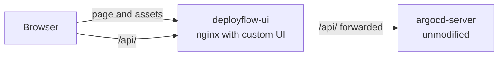

# Customizations

Exactly what DeployFlow changes compared with upstream Argo CD `v3.5.6`, so that upstream work is never mistaken for original work.

## What belongs to whom

| Category | Examples |
|---|---|
| **1. Original upstream functionality** | API server, repo server, application controller, gitops-engine, comparison, sync, health, history and rollback logic, and most UI screens |
| **2. Our UI modifications** | Branding, theme, login page, sidebar, help page, wording |
| **3. Configuration we added** | `deploy/local/`: nginx deployment, plain-HTTP setting, build script |
| **4. New frontend functionality** | Overview panel with counts and recent deployments |
| **5. Excluded from the project** | SSO, ApplicationSets, notifications, multi-cluster, HA, CLI, advanced RBAC |

No Go backend code was changed.

## New files

| File | Purpose |
|---|---|
| `ui/src/app/deployflow-theme.scss` | The whole colour, type and component theme, for light and dark modes |
| `ui/src/app/applications/components/applications-list/deployment-overview.tsx` | Overview panel |
| `ui/src/app/applications/components/applications-list/deployment-overview.scss` | Overview panel styles |
| `ui/src/assets/images/deployflow-mark.svg` | Logo mark and favicon |
| `ui/Dockerfile.deployflow` | Builds the UI, then packages it with nginx |
| `ui/deployflow-nginx.conf` | Serves the UI and forwards `/api/` to the Argo CD server |
| `deploy/local/deployflow-ui.yaml` | Kubernetes Deployment and Service for the UI |
| `deploy/local/build-ui.sh` | Builds the image and loads it into the cluster node |
| `deploy/local/start-deployflow.ps1` | Opens reconnecting connections and both pages |
| `deploy/local/argocd-server-insecure.patch.yaml` | Local-only setting for plain HTTP inside the cluster |

## Modified upstream files

| File | Change |
|---|---|
| `ui/src/app/index.html` | Title, favicon, no-script message |
| `ui/src/app/app.tsx` | Page title, favicon, navigation labels and icons, removed the ApplicationSets link, issue link, loads the theme |
| `ui/src/app/sidebar/sidebar.tsx` | Logo mark, wordmark, DeployFlow version |
| `ui/src/app/login/components/login.tsx` and `login.scss` | New centred sign-in card; removed the mascot and hero text |
| `ui/src/app/help/components/help.tsx` | New links to DeployFlow docs, plus the attribution notice |
| `ui/src/app/shared/components/version-info/version-info-panel.tsx` | Shows the DeployFlow version and the Argo CD engine version |
| `ui/src/app/shared/components/layout/layout.tsx` | Page background colours |
| `ui/src/app/shared/services/view-preferences-service.ts` | Light theme by default |
| `ui/src/app/shared/utils.ts` | Added `DEPLOYFLOW_VERSION` |
| `ui/src/app/applications/components/applications-list/applications-list.tsx` | Shows the overview panel; replaced an empty-state icon |
| Various UI files | Replaced the words "Argo CD" with "DeployFlow" in visible text |

`git diff v3.5.6 -- ui` shows every change line by line.

## Visual identity

The goal was a tool that looks made by a small product team, not generated.

| Choice | Reason |
|---|---|
| Warm neutral background `#f6f5f1` | Softer than pure white or Argo's blue-grey |
| One accent, pine green `#1f5c4d` | Reads as "healthy", the idea the product is about |
| Thin borders, no shadows, 6 to 8 px corners | The plain style of Vercel and Linear |
| System font (Segoe UI on Windows) | Fast and native |
| Sentence case labels | Argo uses uppercase buttons and titles throughout |
| Commit-first overview rows | Borrowed from GitHub's activity lists |
| Light sidebar | Argo's identity is a dark navy sidebar |

Status colours are kept close to upstream because green, yellow and red carry meaning.

## How the customised UI is served

Upstream compiles the UI into the server binary. Replacing it there means rebuilding the server image, which needs a Go toolchain. DeployFlow instead builds only the UI and serves it from nginx:

Everything reaches the browser from one address. That avoids CORS, and the session cookie works as designed.

## Known limits

- Some technical help text still links to upstream documentation, because that is where those settings are documented.
- `argocd-server` still contains the original UI internally, but it is not exposed.
- The login API still returns its token in the response body as well as the `httpOnly` cookie. The UI uses only the cookie.
- Technical names such as the `argocd` namespace and `argocd-server` remain, because they are the real names of the engine's components.
